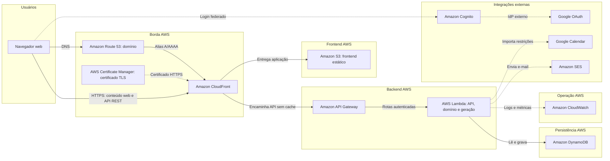
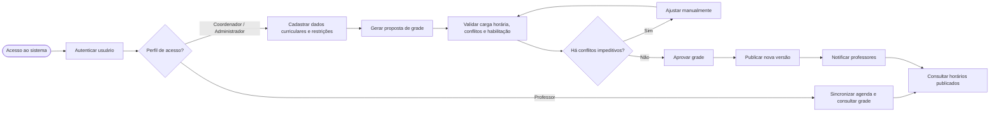
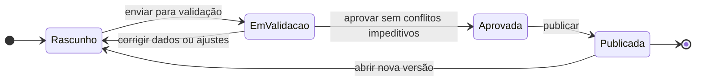

# Diagramas de blocos

Os diagramas abaixo representam uma proposta de arquitetura AWS para o
Classly. A proposta mantém o escopo documentado: aplicação web
cliente-servidor, backend em nuvem, persistência dos dados e integrações com
autenticação, Google Calendar e provedor de e-mail.

## 1. Arquitetura AWS em blocos — MVP econômico

### Serviços AWS representados

| Bloco | Serviço | Responsabilidade |
| --- | --- | --- |
| Domínio | Amazon Route 53 | Resolver o domínio de produção para a CDN e validar o certificado por DNS. |
| Certificado | AWS Certificate Manager | Emitir o certificado TLS usado pelo CloudFront (região `us-east-1`). |
| Borda | Amazon CloudFront | Ponto único de entrada HTTPS: entrega o frontend e encaminha a API sem cache. |
| Frontend | Amazon S3 | Hospedar a aplicação web estática. |
| Entrada | Amazon API Gateway | Expor a API para o CloudFront e acionar as funções. |
| Autenticação | Amazon Cognito + Google OAuth | Autenticar usuários e fornecer tokens para a API. |
| Computação | AWS Lambda | Executar a API em funções separadas por domínio (professores, disciplinas, turmas, habilitações, disponibilidade, grades). |
| Banco | Amazon DynamoDB | Persistir professores, estrutura curricular, habilitações, disponibilidades e rascunhos de grade. |
| E-mail | Amazon SES | Enviar a comunicação de publicação da grade. |
| Observabilidade | Amazon CloudWatch | Centralizar logs, métricas e falhas operacionais. |

## 2. Fluxo principal de geração e publicação

## 3. Ciclo de vida da grade

